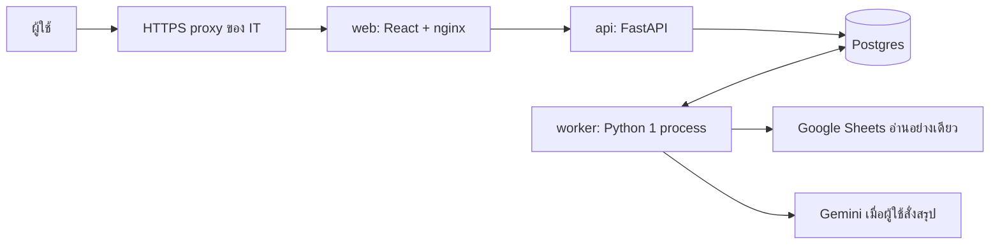

# คู่มือรับช่วงระบบ TFP สำหรับ IT

วันที่ 12 ตุลาคม 2026 (อัปเดต 13 ต.ค.: ล็อกธีมสว่าง, ผลตรวจความปลอดภัย, หัวข้อ 7) · source ที่ตกลงใช้: `acc64eea69d0e0eb870572eef140c051aa331275`

เอกสารนี้เป็นคู่มือระบบบนเครื่องพัฒนา ยังไม่ใช่การอนุมัติเปิด Production ดูผลจริงและงานค้างใน `docs/steps/STEP_08.md` ไม่ใช้ผลของ runtime หนึ่งรับรองอีกเครื่องโดยอัตโนมัติ

## 1. ระบบทำงานอย่างไร

นักเศรษฐศาสตร์ยังกรอกข้อมูลลง Google Sheets ด้วยวิธีเดิม ผู้ใช้กดดึงข้อมูลในเว็บ → worker อ่านชีต → คำนวณด้วยฟังก์ชันเดิม → เก็บข้อมูลและผลใน Postgres → เว็บอ่านผลที่พร้อมแล้ว การแก้ชีตจะยังไม่เปลี่ยนหน้าที่เปิดอยู่จนกดดึงใหม่ โปรแกรมนี้ไม่เขียนกลับชีต



| ส่วน | หน้าที่ | ข้อมูลที่ต้องเก็บ |
|---|---|---|
| web | หน้า React ที่ build แล้ว ส่ง `/api` ไป FastAPI | ไม่มีข้อมูลถาวร |
| api | รับคำสั่ง ตรวจ session/สิทธิ์ ให้ผลและไฟล์ดาวน์โหลด | เก็บใน DB |
| worker | รับงานจากตาราง jobs คำนวณ ดึงชีต สรุปและสร้างรายงาน | เก็บใน DB |
| db | dataset, results, jobs, sessions, downloads และ logs | volume `db-data` ต้องสำรอง |

API/worker ใช้ image เดียวกัน ไม่ใช้ Redis/Celery ไม่มี Streamlit server ในระบบใหม่ แต่มีโค้ดตัวแทน UI เพื่อรักษาการทำงานของหน้าเดิม ไม่ต้องรื้อส่วนนี้เพิ่มเพื่อส่งมอบรอบนี้

## 2. ลองระบบที่เปิดไว้บนเครื่องนี้

Workspace: `/Users/id/Developer/TFP_system_refactor_from_repo_20261009`

เปิด `http://127.0.0.1:8090` จากเครื่องนี้ ระบบ local ใช้ snapshot ชีตและคำตอบ Gemini สังเคราะห์ จึงไม่ใช่ข้อมูลสด/คำตอบจาก Gemini จริง และไม่มีการเรียกบริการจริงจากปุ่มทดสอบเมื่อค่าทั้งสองนี้เปิดอยู่

```sh
cd /Users/id/Developer/TFP_system_refactor_from_repo_20261009
docker compose -p tfp --env-file private/local/env -f deploy/compose.yaml ps
docker compose -p tfp --env-file private/local/env -f deploy/compose.yaml up -d --no-build
docker compose -p tfp --env-file private/local/env -f deploy/compose.yaml logs --tail=100 api worker
```

ปิดชั่วคราวด้วยคำสั่งเดียวกันแต่แทน `ps` ด้วย `stop`; เปิดด้วย `start` ไม่ใช้ `down -v` กับฐานที่ต้องเก็บ ไม่โพสต์ไฟล์ env/ค่าลับหรือ log ทั้งชุดในช่องทางสาธารณะ

วิธีลองสำหรับผู้ใช้:

1. เลือกผู้เยี่ยมชม กดดึงข้อมูล รอผลครั้งแรก แล้วลองเปลี่ยนช่วงพยากรณ์และ scenario
2. เปิดหน้าตัวแปร คู่มือ และแดชบอร์ดนำเสนอ ลองขนาดจอมือถือ (ปุ่มดึงข้อมูลอยู่ในเมนู » มุมซ้ายบน) และสวิตช์ Dark Mode ของแดชบอร์ดนำเสนอ
   เว็บล็อกธีมสว่างเสมอแม้เครื่องตั้งโหมดมืด (ต่างจากต้นฉบับโดยตั้งใจ ผู้ใช้อนุมัติ 12 ต.ค. — `docs/steps/STEP_06.md` หัวข้อ 9.1)
3. กลับหน้าเลือกบทบาท เข้าคณะวิจัยด้วย **บัญชีทดสอบ local** จาก `private/local/secrets.test.toml` (`RESEARCH_USERNAME`/`RESEARCH_PASSWORD`; ไม่ใช่บัญชีเพื่อนและห้ามใช้เปิดจริง ไม่คัดลอกลงเอกสาร/แชต)
4. ลองเปลี่ยนชุดตัวแปรและคืนค่าเดิม ตรวจว่าหน้าจัดการข้อมูลใช้ลิงก์ของ session นี้
5. กดสรุป AI เพียงครั้งเดียว รอ แล้วดาวน์โหลด TXT, Word และ PowerPoint; คำตอบนี้ติดป้ายทดสอบในเนื้อหา
6. ออกจากระบบ ตรวจว่าเข้าหน้าที่ต้องล็อกอินและดาวน์โหลดไฟล์เดิมด้วย session ใหม่ไม่ได้

## 3. เตรียมเครื่องใหม่ — ยังต้องให้ IT ทดลองจริง

VM/โดเมนยังไม่ยืนยัน ต้องมี Docker Engine และ Compose plugin, พื้นที่ DB/backup และ reverse proxy ที่ IT ดูแล ไม่กำหนดว่าเครื่อง x86-64 ผ่านแล้ว: หลักฐาน Linux ปัจจุบันมาจาก arm64 บน Docker Desktop

| ค่าใน `deploy/.env` | วิธีใช้ |
|---|---|
| `TFP_DB_PASSWORD` | รหัสฐานใหม่ของระบบนี้ ตั้งโดย IT ไม่ใช่รหัสของเพื่อน; ถ้าเปลี่ยนบน volume เดิมต้องเปลี่ยนใน Postgres ด้วย |
| `TFP_ALLOWED_ORIGINS` | URL ที่ผู้ใช้เปิดจริง เช่น `https://tfp.example.go.th` ต้องตรง protocol/host/port |
| `TFP_COOKIE_SECURE` | `1` สำหรับ HTTPS; `0` เฉพาะ local HTTP |
| `TFP_SECRETS_PATH` | path ไฟล์ TOML เดิมบน host; mount อ่านอย่างเดียว ไม่ใส่ลง image/Git |
| `TFP_WEB_BIND`, `TFP_WEB_PORT` | เริ่มจาก loopback และให้ proxy ต่อมา ห้ามเปิด DB/API สาธารณะ |
| `TFP_SESSION_IDLE_MINUTES`, `TFP_SESSION_MAX_HOURS` | ปัจจุบัน 240 นาที/24 ชั่วโมง ให้ IT ยืนยัน |
| `TFP_SHEETS_FIXTURE`, `TFP_GEMINI_FIXTURE` และ mount ของแต่ละตัว | เฉพาะทดสอบ ต้องว่างในระบบจริง ตรวจใน container อีกครั้งก่อนเปิด |

ต้นแบบคำสั่งสำหรับเครื่องใหม่ **ยังไม่ใช่ผลทดสอบบน VM ของ IT**:

```sh
cp deploy/.env.example deploy/.env
# IT ใส่ค่าจริงในไฟล์โดยไม่ส่งออกมาทางแชต และตรวจสิทธิ์การอ่านไฟล์
docker compose --env-file deploy/.env -f deploy/compose.yaml build
docker compose --env-file deploy/.env -f deploy/compose.yaml up -d
```

ห้าม upgrade Python/numpy/pandas/scipy/statsmodels เพื่อแก้ build โดยไม่มีการตรวจตัวเลขใหม่ หากใช้ DB ของ IT ต้องปรับ Compose/network และตรวจ version, role, migration, backup/restore ไม่ใช่เพียงเปลี่ยน connection string

## 4. สำรองและกู้คืน

มี `deploy/backup.sh` และ `deploy/restore.sh` ที่เขียนเพิ่มสำหรับงานนี้ ผลทดสอบอยู่ `private/verification/dev-step8-backup-r1/` สำรองจากฐาน local และกู้คืนใน Postgres ชั่วคราวที่ปิดเครือข่ายแล้ว ตรวจ dataset/results/downloads/fetch_log ตรงทั้งเนื้อหา

```sh
# ใช้ชื่อ container ที่ยืนยันจาก compose ps; โฟลเดอร์ปลายทางต้องมีอยู่
sh deploy/backup.sh tfp-db-1 /secure-backups/tfp-YYYYMMDD-HHMM.dump
# กู้คืนเข้า DB ใหม่เท่านั้น ใช้ container ทดสอบของ IT
sh deploy/restore.sh RECOVERY_DB_CONTAINER tfp_restore_check /secure-backups/tfp-YYYYMMDD-HHMM.dump
```

คำสั่งแรกไม่เขียนทับไฟล์เดิมและสร้างด้วย permission จำกัด หากล้มเหลวอย่าใช้ไฟล์บางส่วนเป็น backup ที่สมบูรณ์ คำสั่งหลังปฏิเสธชื่อ DB ที่ไม่ขึ้นต้น `tfp_restore_` และ DB ที่มีอยู่แล้ว ยังไม่สลับแอปไปใช้ฐานที่กู้คืน ให้ IT ตรวจผลก่อนเปลี่ยน connection

Dump มีข้อมูลจากชีต/session/รายงาน ต้องจัดเก็บตามสิทธิ์ สำเนานอกเครื่องและการเข้ารหัสเป็นงานของ IT ที่ยังไม่ติดตั้งให้ในรอบนี้ Volume ไม่ใช่ backup นอกเครื่อง ต้องเก็บไฟล์ตั้งค่า/ค่าลับในระบบสำรองลับของหน่วยงานแยกจาก dump

Rollback โค้ด: เก็บ image ID ของรุ่นที่ตรวจรับและ dump ก่อนเปลี่ยนรุ่น ทดสอบกับฐานสำเนาก่อนสลับจริง อย่า downgrade migration หรือทับฐานจริงอัตโนมัติ ปัจจุบันยังไม่มี release tag ที่ commit แล้ว

## 5. หลักฐานที่ใช้รับมอบและเรื่องที่ยังต้องตัดสิน

- อ่าน `STEP_07.md`, `STEP_08.md`, `STEP_SRC_7bf84e4.md` และ `RUNTIME_DIFFERENCES.md` ควบคู่กัน เกณฑ์ A ต้องตรงทุกบิตกับโค้ดเดิมบน runtime เดียวกัน ส่วนความต่าง Mac/Linux/VM เป็นเกณฑ์ B ที่ยังต้องรับรอง
- baseline จริงอยู่ `private/` ส่งให้ผู้มีสิทธิ์แยกจาก Git; รัน `tools/refactor/test_in_image.sh` ด้วย runtime image ID ที่มี reference ตรงกัน ห้ามสร้าง expected ใหม่จากโค้ด refactor เพื่อทำให้ test ผ่าน
- security ที่มี: session ฝั่ง DB, cookie HttpOnly/SameSite, CSRF+Origin, หมุน token เมื่อ login/logout, จำกัดการลองรหัส, event/fetch limits, ไฟล์แยกเจ้าของ, DOMPurify/CSP และ worker แยกงานหนัก ดูผลเฉพาะกรณีใน STEP_08 ไม่ใช่ใบรับรอง penetration test
- ต้องให้ IT ยืนยัน HTTPS/proxy/domain/iframe origins, IP ที่เชื่อถือ, egress ไป Google, อายุ session, backup schedule/retention และคนดูแล/คนตรวจโมเดล
- ปัจจุบันยังใช้บัญชีคณะวิจัยแบบต้นฉบับ ไม่มี OIDC/บัญชีรายคน/audit รายบุคคล ให้หน่วยงานตัดสินก่อนเปิดจริง ไม่เปลี่ยนคีย์หรือบัญชีเพื่อนในงานนี้
- หน้า public ยังมีการกดดึงข้อมูลและ API สร้าง session ใหม่ได้: per-session limits ไม่ใช่เพดานรวมต่อ IP ต้องประเมิน proxy limits/เพดานงานรวมและการเก็บกวาด sessions/jobs/downloads ก่อนเปิดสาธารณะ
- `/api/v1/health` ต้องอ่าน JSON `status=ok` ด้วย: HTTP 200 อย่างเดียวอาจเป็น `degraded` เมื่อ worker หาย ทีมพัฒนา แก้ healthcheck ในไฟล์ Compose ให้ตรวจ JSON นี้แล้ว และ recreate ชุด local เพื่อใช้ค่าใหม่แล้ว; worker ส่ง heartbeat ระหว่างงานยาวด้วย (แก้หนึ่งจุด ไม่เปลี่ยนสูตร) มี focused tests และ built-image smoke รองรับ; ยังต้องตรวจการแจ้งเตือนจริงบนเครื่องรับมอบ
- การตั้งค่า `X-Forwarded-For` ปัจจุบันใช้ peer ของ nginx; หลัง proxy หน่วยงานอาจกลายเป็น IP ร่วม ต้องตั้ง trust ให้ตรง topology ก่อนใช้เพดานตาม IP
- `.gitignore` ต้นฉบับยังเป็น read-only; ตอนนี้ข้อมูล private ถูกกันด้วย `private/.gitignore` ที่ไม่ขึ้น Git ก่อน commit/ส่งโค้ดต้องเพิ่มกฎกัน private/credentials ในกฎที่ติดไปกับ repo และตรวจรายการ staged อีกครั้ง
- ยังต้องตรวจ live Sheets/Gemini โดยผู้มีสิทธิ์, browser/mobile จริง, Word/PowerPoint ใน Microsoft Office, หน้าคณะวิจัยต้นฉบับ และ load test บน VM เป้าหมาย อย่าแปลว่า offline ผ่านแล้วเปิดจริงได้ทันที

ผู้รับผิดชอบที่ต้องระบุ: ผู้ดูแล VM/backup, ผู้ดูแลบัญชีและ Sheets, ผู้รู้โมเดลที่รับรองผลข้าม runtime และเจ้าของผลิตภัณฑ์ที่รับรองหน้าจอ/ฟีเจอร์

## 6. ผลตรวจล่าสุดบนเครื่องพัฒนา

การตรวจอัตโนมัติ Step 8 ผ่านแล้ว: frontend 34 ข้อ, คิวงาน/worker/security/contract ชุดที่เกี่ยวข้อง 21 ข้อ, backup/restore และ Compose e2e แบบรันเดี่ยวผ่าน รวม restart และกู้คืน worker ที่หยุดกลางงาน ผลรอบที่ไม่ผ่านเก็บไว้ใน STEP_08 ไม่ใช่การรับรอง Production

วัด warm reads 5 คำขอต่อเนื่องและ cold fetch ในรอบ r4 แล้ว (ค่าแต่ละครั้งอยู่ STEP_08) โดย warm reads ไม่สร้างงานคำนวณเพิ่ม และ cold timing ไม่รวม Google จริง ยังไม่มี controlled comparison กับ Streamlit หรือ load test บน VM เป้าหมาย รายละเอียดเวลาและขอบเขตอยู่ STEP_08

nginx upstream ใช้ Docker DNS resolver เพื่อหา API ใหม่เมื่อ IP เปลี่ยน ตรวจด้วยการบังคับเปลี่ยน IP แล้วและ e2e restart ผ่าน เว็บ local 8090 อัปเดตเป็น config นี้แล้ว โดยเก็บ image รุ่นก่อนให้ย้อนกลับและไม่ล้างฐานข้อมูล

## รอบรับ source 4c8aa71 (21 ต.ค. 2026)

ผลและงานรอตรวจรับอยู่ `docs/steps/STEP_SRC_4c8aa71.md` — การทดสอบย้อนหลัง (Rolling/Hold-out) คำนวณเมื่อผู้ใช้กดปุ่ม "▶ เริ่มการทดสอบย้อนหลัง"
(ครั้งแรกต่อชุดข้อมูลราว 35–90 วินาที แล้วเก็บใน DB ใช้ร่วมทุก session) ไม่ใช้ไฟล์ backtest_cache.pkl ของต้นฉบับ; การดึงข้อมูลเร็วขึ้นเหลือราวไม่กี่วินาที
ตัวแปร `TFP_SHEETS_FIXTURE_DELAY` ใช้เฉพาะ e2e ในโหมด fixture ระบบจริงต้องไม่ตั้ง

## รอบรับ source acc64ee

ผลล่าสุดและงานรอตรวจรับอยู่ `docs/steps/STEP_SRC_acc64ee.md` เวลา/visual QA รุ่นก่อนในคู่มือนี้เป็นประวัติ เว็บ local อัปเดตและคง DB เดิม กดดึงข้อมูลจาก fixture ใหม่เพื่อรับ mapping ของตัวแปรรุ่นนี้ก่อนทดลองเพิ่มตัวแปร ไม่ได้เรียก Google Sheets สด

## 6.1 ขอบเขตการใช้งานที่ตกลง (20 ต.ค. 2026 — จากผู้ใช้หลังคุยกับเจ้าของระบบ)

- **ระยะแรก: ใช้ภายในสำนักงาน** ผู้ใช้ 2 กลุ่ม — นักวิจัยทั่วไปที่ศึกษาเพิ่มเติม (โหมดผู้เยี่ยมชม ไม่ต้องล็อกอิน) และทีมวิจัยที่ดูแลทฤษฎี/ตัวแปร (โหมดคณะวิจัย ใส่รหัส)
- **บัญชี:** ใช้บัญชีคณะวิจัยร่วมแบบต้นฉบับไปก่อน ไม่ทำระบบสมัครสมาชิก — เปลี่ยนรหัสเมื่อมีคนออกจากทีม; บัญชีรายคน/ล็อกอินด้วยบัญชีหน่วยงาน (SSO) เป็นงานอนาคต (ขอบเขต B)
- **ผลต่อการ deploy:** แนะนำให้เข้าได้เฉพาะเครือข่ายสำนักงาน/VPN (จำกัด IP ที่ proxy) แทนเปิดอินเทอร์เน็ตทั่วไป — ลดความเสี่ยงหน้าผู้เยี่ยมชมกดดึงข้อมูลซ้ำ (L-4) และการเดารหัสบัญชีร่วม;
  M-1 (นับล็อกอินผิดรวม) ยิ่งสำคัญเพราะคนในสำนักงานมักออกเน็ตด้วย IP เดียวกัน
- **อนาคต: อาจนำไปแปะหน้าเว็บไซต์ สอวช. และมีผู้พัฒนาต่อ** — ถ้าฝังด้วย iframe ต้อง (1) เพิ่มโดเมนเว็บไซต์ใน CSP `frame-ancestors` (`deploy/web.conf`, ปัจจุบัน `'self'`)
  (2) cookie session เป็น `SameSite=lax` จะ**ไม่ถูกส่งใน iframe ข้ามไซต์** → ใช้ subdomain ของโดเมนเดียวกัน (เช่น `tfp.<โดเมน สอวช.>`) หรือใช้ลิงก์เปิดหน้าใหม่แทน iframe (ง่ายและปลอดภัยกว่า)
  (3) ถ้าเปิดหน้าผู้เยี่ยมชมสู่สาธารณะ ต้องทำ L-4 rate limit และประเมินโควตา Google Sheets/Gemini ก่อน; ปุ่มสรุป AI อยู่เฉพาะหน้าคณะวิจัย

## 7. ความปลอดภัย: ผลตรวจระดับโค้ด และ checklist ตอน deploy (13 ต.ค.)

ผลตรวจเต็ม: รายงานความปลอดภัย (ส่งให้ IT แยก ไม่อยู่ใน repo สาธารณะ) — ยิงทดสอบ local 74 ข้อ ไม่ผ่าน 0, XSS 30 payload ผ่าน, npm audit 0, ไม่พบคีย์/ข้อมูลใน image
ไม่ใช่ penetration test อย่างเป็นทางการ ก่อนเปิดสาธารณะต้องให้ผู้ตรวจภายนอกทดสอบบน VM จริง

ต้องทำบน VM ก่อนเปิดใช้ (ตรวจได้ด้วย `tools/security/probe_local.py https://<โดเมน>` หลังตั้งค่า):

| # | เรื่อง | ทำอย่างไร | ตรวจผ่านเมื่อ |
|---|---|---|---|
| 1 | HTTPS | proxy ของ IT ใช้ TLS 1.2+ และตั้ง HSTS; `TFP_COOKIE_SECURE=1`; `TFP_ALLOWED_ORIGINS` = URL จริงเท่านั้น | cookie มี `Secure`, มี `Strict-Transport-Security`, POST จาก origin อื่นได้ 403 |
| 2 | IP จริงหลัง proxy (M-1) | Compose ตั้ง `TFP_TRUST_PROXY=1` อยู่แล้ว; ให้ nginx `set_real_ip_from <IP proxy ของ IT เท่านั้น>` + `real_ip_header X-Forwarded-For` เพื่อเชื่อเฉพาะ proxy ที่กำหนด | ผิด 5 ครั้งจากเครื่อง A แล้วเครื่อง B (คนละ IP) ยังล็อกอินได้; ส่ง `X-Forwarded-For` ปลอมแล้วไม่มีผล; ทดสอบกรณีคนในสำนักงานใช้ IP ออกเน็ตร่วมกัน |
| 3 | container hardening (M-2) — ทดสอบใน Compose แยกก่อน | web รันแบบ non-root, `cap_drop: [ALL]` (คืนเฉพาะที่จำเป็น), `no-new-privileges`, `read_only` + tmpfs, `mem_limit`/`pids_limit` | `docker inspect` ตรงค่า และ e2e ผ่านซ้ำ |
| 4 | พอร์ต | เปิดออกนอกเครื่องแค่ 443 ของ proxy; web bind loopback; DB/API ไม่ publish | สแกนพอร์ตจากภายนอกเห็นแค่ 443 (และ SSH จากเครือข่ายที่อนุญาต) |
| 5 | rate limit รวม (L-4) | proxy จำกัดคำขอต่อ IP และจำนวน session ใหม่ต่อ IP | ยิงเกินเพดานได้ 429 ที่ proxy |
| 6 | ไลบรารี (L-1) | งานแยก: อัปเกรด Pillow ≥ 12.3.0 แล้วตรวจไฟล์ Word/PPTX และ test ที่เกี่ยวข้องซ้ำ (lock ตรึงกับ reference — ขอบเขต B) | `tools/security/osv_python.py` ไม่พบรายการ |
| 7 | สัญญา API (L-2) | ตัดสินว่าจะปิด `/api/v1/openapi.json` ใน production หรือไม่ | ตามที่ตัดสิน |
| 8 | ค่าทดสอบ | `TFP_SHEETS_FIXTURE`/`TFP_GEMINI_FIXTURE` ว่าง; ใช้รหัสคณะวิจัยจริงที่เจ้าของส่งผ่านช่องทางลับ ไม่ใช่บัญชีทดสอบ | ตรวจ env ใน container |
| 9 | backup | dump เข้ารหัส เก็บนอกเครื่อง มีผู้รับผิดชอบ ทดสอบกู้คืนตามหัวข้อ 4 | กู้คืนในฐานทดสอบได้ครบ |

การเปิดลิงก์ชั่วคราวผ่าน Cloudflare Quick Tunnel (12–13 ต.ค.) ใช้สำหรับให้ตรวจงานเท่านั้น ไม่ใช่ทางเลือก production:
URL สุ่มเปลี่ยนทุกครั้ง ไม่รับประกัน uptime ต้องเปิด Mac ไว้ และบั๊ก "กดดึงข้อมูลแล้วไม่ส่งคำขอ" ผ่าน tunnel บน iPhone ยังอยู่ระหว่างแก้ (ทีมพัฒนา, ดู WORK_LOG)

ผลตรวจล่าสุดอื่น: API/DB/worker 44 ผ่าน (`private/verification/api-after-lightlock-20261013-r1/`), contrast ทุกหน้า 0 รายการผิดทั้งธีมสว่าง/มืด (`contrast-final-new-r1`)
